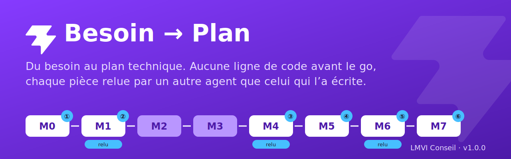
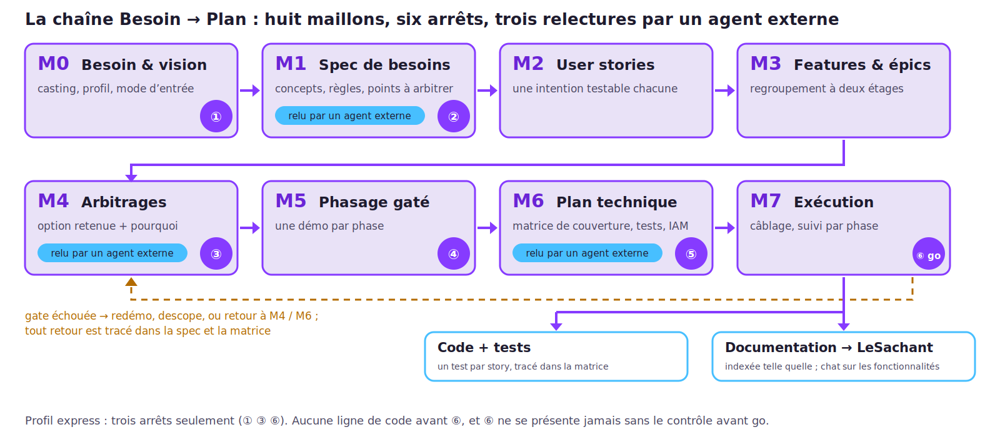
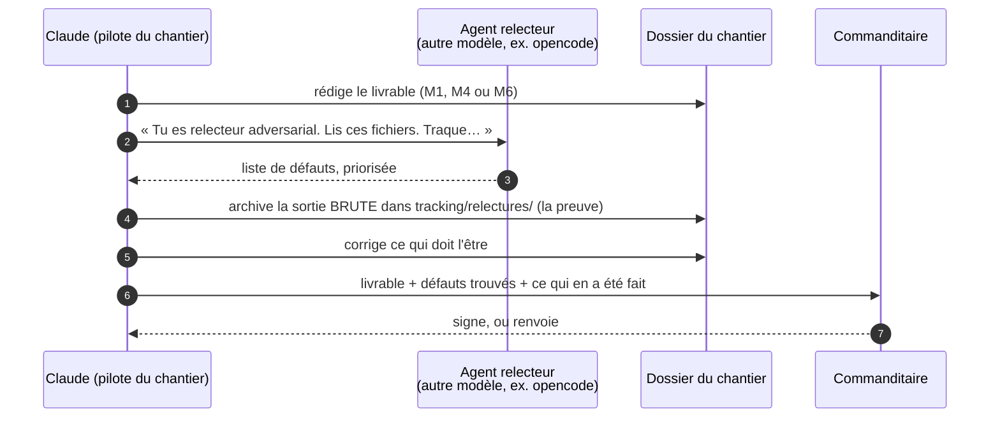
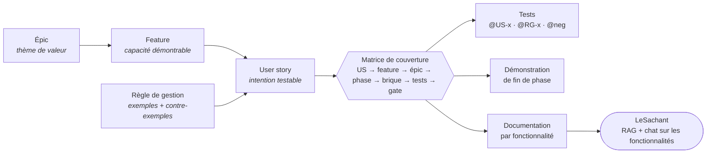

<p align="center">
  
</p>

<p align="center">
  <a href="https://github.com/Lmvi-Conseil/besoin2plan/releases/latest"></a>
  <a href="LICENSE-CC-BY-4.0"></a>
  <a href="LICENSE"></a>
  
  
</p>

# Besoin → Plan

**Une méthode pour passer d'un besoin exprimé à un plan technique exécutable, menée par un agent
IA, sans écrire une ligne de code avant que le commanditaire ait dit « go ».**

Un agent de développement va vite. Trop vite, si rien ne le retient : il code la première
interprétation du besoin, invente ce qui manque, et livre un résultat propre qui répond à une
question que personne n'a posée. Le défaut n'est pas la vitesse. C'est l'absence de point
d'arrêt : le commanditaire n'a jamais eu l'occasion de dire « oui, c'est ça » avant que le code
existe.

Besoin → Plan met ces points d'arrêt. La méthode descend du besoin aux **épics**, aux
**features** et aux **user stories**, en tire les **tests**, fait relire chaque pièce importante
par **un autre agent que celui qui l'a écrite**, et laisse derrière elle une **documentation
qu'un assistant peut interroger**. Elle est livrée avec un kit de gabarits, un générateur de
fiches, une grille de contrôle avant go, et une **skill Claude Code** qui la déroule d'elle-même.

> Besoin → Plan est la méthode de conception de la démarche **AgileIA** de
> [LMVI Conseil](https://www.lmvi-conseil.fr). Elle a été mise au point sur des chantiers réels de
> la plateforme TheSocle entre juillet et octobre 2026, et est publiée ici en version 1.0.0.

---

## Sommaire

- [La méthode en une image](#la-méthode-en-une-image)
- [Trois principes](#trois-principes)
- [La chaîne : huit maillons, six arrêts](#la-chaîne--huit-maillons-six-arrêts)
- [Relu par un autre agent, piloté par Claude](#relu-par-un-autre-agent-piloté-par-claude)
- [Des épics aux tests, puis à la documentation](#des-épics-aux-tests-puis-à-la-documentation)
- [Pourquoi pas le « spec-driven development » ?](#pourquoi-pas-le--spec-driven-development--)
- [Démarrer en cinq minutes](#démarrer-en-cinq-minutes)
- [Ce que contiennent les zips](#ce-que-contiennent-les-zips)
- [Profils et modes d'entrée](#profils-et-modes-dentrée)
- [Mesuré sur un chantier réel](#mesuré-sur-un-chantier-réel)
- [Ce que la méthode ne fait pas encore](#ce-que-la-méthode-ne-fait-pas-encore)
- [Le dépôt](#le-dépôt)
- [Licence](#licence)

---

## La méthode en une image

<p align="center">
  
</p>

Huit maillons, de la vision (M0) à l'exécution (M7). Le commanditaire s'arrête six fois pour
décider ; trois maillons sont relus par un agent externe. À la sortie : le code et ses tests,
tracés story par story, et une documentation que l'application LeSachant indexe pour en faire un
assistant.

---

## Trois principes

**1. La preuve externe.** Tout artefact est prouvé par quelque chose qui n'est pas lui. Une
exigence par son test. Une règle de gestion par le contre-exemple qu'elle rejette. Une phase par
sa démonstration. Une sauvegarde par sa restauration. Une spécification par un relecteur qui ne
l'a pas écrite. *Ce qui n'a pas de preuve externe est une opinion bien formatée.*

**2. Trois axes qu'on ne mélange jamais.**

| Axe | Ce qu'il range | Il répond à |
|---|---|---|
| **Métier** | Épic → Feature → User story | *quelle capacité on promet* |
| **Technique** | workers, services, paquets | *avec quelles briques on la construit* |
| **Livraison** | phases, chacune fermée par une démonstration | *quand, et comment on la montre* |

Un artefact ne porte qu'un axe. Le seul endroit où les trois se croisent est la **matrice de
couverture** : chaque story y est tracée jusqu'à sa brique, sa phase, ses tests et sa démo.

**3. Décider avant de construire.** Les décisions structurantes se prennent avant le plan,
s'écrivent avec leur *pourquoi*, et rien ne se code tant qu'une décision bloquante est ouverte. Le
doute n'est pas interdit : il est marqué `[À ARBITRER]`, puis tranché, jamais enfoui dans le code.

Les deux pages à lire en premier : [`ESSENTIEL.md`](ESSENTIEL.md), la philosophie sans un seul
gabarit, et [`PRESENTATION.md`](PRESENTATION.md), la méthode expliquée à quelqu'un qui ne code pas.

---

## La chaîne : huit maillons, six arrêts

| Maillon | Livrable | Arrêt du commanditaire | Relu par un agent externe |
|---|---|:---:|:---:|
| **M0** Besoin & vision | vision en 3 à 5 lignes, principe directeur, acteurs, casting, profil, mode d'entrée | ① confirmer la vision | |
| **M1** Spécification de besoins | concepts, entités, règles de gestion en fiches, matrice des habilitations, exigences non fonctionnelles — *le quoi, jamais le comment* | ② signer | ✅ |
| **M2** User stories | une intention testable par story, avec ses critères d'acceptation | | |
| **M3** Features & épics | le regroupement à deux étages : stories → features → épics | | |
| **M4** Arbitrages | chaque point ouvert : options, recommandation, décision et son motif | ③ trancher | ✅ |
| **M5** Phasage | des phases, chacune fermée par une **démonstration réelle** | ④ valider | |
| **M6** Plan technique | ce qu'on ne code pas, briques nouvelles, modèle de données, **matrice de couverture**, plan de test, habilitations → IAM | ⑤ valider | ✅ |
| **M7** Exécution | câblage : où va le code, avec quoi, sur quoi ; suivi par phase | ⑥ **go** | |

**L'arrêt ⑥ ne se présente jamais nu.** Avant de demander le go, le pilote remplit une grille de
contrôle, lance un script qui vérifie les points mécaniques, et présente la grille avec son
verdict. Tout écart non levé bloque le go.

**Quand le réel contredit le papier**, la méthode a des boucles de retour : une démonstration qui
échoue ne ferme pas sa phase ; un apprentissage qui invalide la spécification s'y propage, daté ;
une story n'est jamais supprimée, elle est scindée ou abandonnée avec sa raison. Et la méthode sait
**arrêter** un chantier : deux portes ajournées de suite sur la même phase déclenchent une
proposition d'arrêt, que le commanditaire tranche.

Tout est détaillé dans [`conception/METHODE-Besoin2Plan.md`](conception/METHODE-Besoin2Plan.md).

---

## Relu par un autre agent, piloté par Claude

C'est le point qui distingue le plus la méthode. **La spécification (M1), les arbitrages (M4) et
le plan technique (M6) ne sont pas relus par celui qui les a écrits**, ni par une seconde session
du même modèle — la méthode appelle cela une relecture de confort, insuffisante seule. Ils sont
relus par un **agent extérieur, différent en nature** : un autre modèle de langage, lancé en ligne
de commande, ou un humain du métier.



La consigne du relecteur est écrite dans le kit : réexpliquer le domaine avec ses mots — s'il n'y
arrive pas, la spécification échoue —, puis traquer les termes non définis, les règles sans
contre-exemple, les habilitations incohérentes, les décisions déguisées en descriptions, le
*comment* qui a fui dans le *quoi*. **Si le relecteur prévu est indisponible, Claude le dit et
demande lequel employer. Il n'a pas le droit de présenter sa propre relecture comme externe.**

Une spécification qui sort de là a été contredite au moins une fois avant d'être signée.

---

## Des épics aux tests, puis à la documentation

La chaîne ne produit pas un document : elle produit une **hiérarchie**, et c'est elle qui rend les
tests possibles.



- **Chaque story a exactement une feature, chaque feature exactement un épic**, aucun n'est vide.
  Un petit chantier crée tout de même ses épics, au besoin avec une feature-enveloppe.
- **Chaque story a au moins un test d'acceptation** (`@US-x`), **chaque règle deux** : le cas
  conforme et le cas rejeté (`@RG-x`), **chaque interdiction d'accès un test négatif** (`@neg`).
  Le générateur écrit les squelettes Gherkin à partir des critères d'acceptation et des exemples.
- **La matrice de couverture** se lit dans les deux sens : verticalement, aucune story oubliée ;
  horizontalement, aucune brique codée en trop. Une story sans test s'y voit comme un trou. Le
  script de contrôle avant go le détecte.

**La documentation est le dernier produit de la chaîne.** Spécification, fiches de règles,
stories, arbitrages avec leur *pourquoi*, matrice : tout cela décrit l'application en termes de
**fonctionnalités**, pas de fichiers. C'est exactement la matière dont a besoin **LeSachant**,
l'application de la plateforme TheSocle à qui l'on pose des questions sur une autre application :
« comment marche telle fonction ? », « que se passe-t-il si l'auteur est inconnu ? ». LeSachant
indexe la documentation et le code dans une recherche hybride, et répond en citant ses sources.
Son chat est **concentré sur les fonctionnalités** de l'application interrogée : il ne parle que de
ce que la documentation dit, et dit quand elle ne dit rien. Sur son premier corpus, 527 documents
découpés en 4 154 morceaux, ses réponses sont mesurées sur un banc de trente questions rejoué à
chaque réglage.

Une documentation écrite après coup se reconstitue à grands frais. Celle-ci existe **avant** le
code, tracée jusqu'aux tests, relue par un tiers : un assistant l'indexe telle quelle.

> LeSachant n'est pas publié dans ce dépôt. Toute chaîne RAG peut consommer la documentation que
> la méthode produit : elle est en Markdown, rangée par maillon, et chaque fiche porte ses liens.

---

## Pourquoi pas le « spec-driven development » ?

Le *spec-driven development* (SDD) est l'approche que proposent les outils d'agents de code depuis
2025 : [Spec Kit](https://github.com/github/spec-kit) chez GitHub, les
[specs de Kiro](https://kiro.dev/docs/specs/concepts) chez Amazon. L'idée de départ est la même que
la nôtre, et elle est juste : **écrire la spécification avant de laisser l'agent coder.** Spec Kit
enchaîne une constitution du projet, une spécification par fonctionnalité, un plan, des tâches et
l'implémentation. Kiro produit trois fichiers par spec — exigences en notation EARS, conception,
tâches — avec un point de revue entre chaque phase.

Ce que nous n'y avons pas trouvé, et dont nous avions besoin :

| | Spec Kit | Kiro | **Besoin → Plan** |
|---|:---:|:---:|:---:|
| Spécification avant le code | ✅ | ✅ | ✅ |
| Artefacts en Markdown dans le dépôt | ✅ | ✅ | ✅ |
| **Relecture imposée par un agent différent en nature**, sortie archivée comme preuve | — | — | ✅ M1, M4, M6 |
| **Arrêts du commanditaire** qui bloquent le passage au code | revue libre | revue entre phases | ✅ six arrêts, contrôle avant go |
| **Arbitrages** consignés comme un livrable, avec leur motif | — | — | ✅ M4 |
| Hiérarchie **épics → features → stories** | une spec par fonctionnalité | une spec par fonctionnalité | ✅ obligatoire |
| **Matrice de couverture** story → brique → phase → tests → démo | étiquettes de story sur les tâches | — | ✅ M6 |
| Fin de phase par **démonstration réelle** | — | — | ✅ |
| **Documentation pensée pour un assistant** (RAG) | — | — | ✅ |
| Mode d'entrée « **cahier des charges fourni** », avec traçabilité | — | — | ✅ |
| Seuil : **ne rien dérouler** sous une certaine taille | — | — | ✅ |

*Comparaison établie d'après la documentation publique des deux outils au 26 octobre 2026. Un
« — » signifie que nous ne l'y avons pas trouvé, pas que c'est impossible à ajouter.*

Aucun de ces manques n'est un défaut de ces outils : **ils visent le développeur seul devant son
agent.** Nous visions autre chose : un commanditaire qui décide, une preuve extérieure à chaque
pièce, et une documentation qui survit au chantier. **C'est pour cela que nous avons écrit notre
propre méthode** plutôt que d'en adopter une, en gardant de SDD ce qui marche : la spécification
avant le code, et des artefacts en Markdown dans le dépôt.

---

## Démarrer en cinq minutes

### Avec Claude Code — la skill

```bash
# 1. installer la skill (kit embarqué)
git clone https://github.com/Lmvi-Conseil/besoin2plan.git
cd besoin2plan && ./installer-skill.sh

# 2. pour la relecture externe, installer un second agent (facultatif mais recommandé)
#    https://opencode.ai — sinon la skill vous demandera quel relecteur employer

# 3. dans Claude Code, sur le dossier de votre application
/besoin2plan apps/mon-application
```

La skill monte `docs/chantier/` dans ce dossier, y copie le kit, détermine le mode d'entrée — un
cahier des charges posé dans `docs/specifications/`, ou trois phrases qu'elle vous demande —, puis
déroule la chaîne. Elle s'arrête à chaque décision qui vous revient, tient un journal
`PILOTAGE.md`, et reprend là où elle s'était arrêtée si vous la relancez. Détails :
[`skill/besoin2plan/README-INSTALL.md`](skill/besoin2plan/README-INSTALL.md).

### Sans la skill — le kit et le prompt pilote

1. Téléchargez **`besoin2plan-kit-v1.0.0.zip`** depuis la
   [release](https://github.com/Lmvi-Conseil/besoin2plan/releases/latest) et dézippez-le dans
   `docs/chantier/` de votre application : vous obtenez `docs/chantier/_kit/`.
2. Remplissez une fois `_kit/CONTRAT-ARCHITECTURE.md` pour votre plateforme. L'exemple
   [`exemples/profil-thesocle/`](exemples/profil-thesocle/) montre une version complète.
3. Ouvrez votre agent dans `docs/chantier/` et collez le prompt de
   [`conception/PROMPT-PILOTE.md`](conception/PROMPT-PILOTE.md), avec votre besoin ou le chemin de
   votre cahier des charges.

Le pas à pas complet, avec un prompt prêt à coller pour chaque maillon, est dans
[`USAGE.md`](USAGE.md).

---

## Ce que contiennent les zips

Chaque release publie deux archives et leurs sommes de contrôle.

**`besoin2plan-kit-v1.0.0.zip`** — le kit, à déposer dans un chantier :

```
_kit/
├── KIT-VERSION.txt                 v1.0.0
├── ESSENTIEL.md                    la philosophie en une page
├── USAGE.md                        le pas à pas et les prompts par maillon
├── METHODE-Besoin2Plan.md          la référence : principes, maillons, boucles de retour, matrice
├── PROFILS.md                      seuil, modes d'entrée, profils express / solo / client
├── PROMPT-PILOTE.md                LE prompt qui déroule tout le chantier
├── PROMPT-generer-fiches-US.md     générer les fiches, par script ou par prompt
├── CONTRAT-ARCHITECTURE.md         le contrat de votre plateforme, à remplir
├── TEMPLATE-M0 … TEMPLATE-M7       un gabarit par maillon
├── TEMPLATE-US / FEATURE / EPIC    les fiches de la hiérarchie métier
├── TEMPLATE-RG                     une règle de gestion : énoncé, exemples, contre-exemples
├── TEMPLATE-HABILITATIONS          la matrice rôle × story, signée par le métier
├── TEMPLATE-TESTS                  le plan de test par phase, gate en une commande
├── TEMPLATE-PARCOURS-MAQUETTES     les parcours des stories pivots, validés avant M6
├── TEMPLATE-INTERFACES-REPRISE     systèmes existants et reprise de données
├── TEMPLATE-CONTROLE-AVANT-GO      la grille de l'arrêt ⑥
├── TEMPLATE-RETEX                  le retour d'expérience qui fait évoluer le kit
├── gen-fiches-us.py                le générateur : fiches, matrice, squelettes de tests
├── us-data.example.yml             un jeu de données complet, issu d'un chantier réel
├── controle-avant-go.sh            les points mécaniques du contrôle avant go
├── conformite/                     PV de recette, RGPD, risques, avenants, audit
└── run/                            environnements, exploitation, CI et revue, doc et formation
```

**`besoin2plan-skill-v1.0.0.zip`** — la skill Claude Code, kit embarqué :

```
besoin2plan/
├── SKILL.md                        ce que Claude exécute quand vous tapez /besoin2plan
├── README-INSTALL.md
└── reference/kit/                  le même kit que ci-dessus
```

À dézipper dans `~/.claude/skills/`, ou dans `.claude/skills/` d'un seul projet.

---

## Profils et modes d'entrée

**Le profil règle le niveau d'outillage, jamais la taille des documents.**

| Profil | Arrêts | Pour |
|---|---|---|
| **express** | 3 : ① vision · ③ arbitrages · ⑥ go | une fonctionnalité courte, domaine connu, sans enjeu contractuel |
| **solo** | les 6 | une application interne complète |
| **client** | les 6 + un procès-verbal à chaque porte | un chantier contractuel ; ajoute les piliers conformité et exploitation |

**Deux modes d'entrée.** *Besoin exprimé* : quelques phrases, M0 et M1 s'écrivent en reformulant.
*Cahier des charges fourni* : M0 et M1 s'en **extraient**, chaque story et chaque règle cite son
paragraphe d'origine, et les trous du document deviennent les points à arbitrer. Zéro invention.

**Et un seuil.** Si l'intention tient dans un message et se prouve par un test, on ne déroule
rien : on fait, on prouve, on journalise. Une méthode appliquée à un correctif de deux heures est
le meilleur moyen de la faire contourner ensuite.

---

## Mesuré sur un chantier réel

IdéeBox est une boîte à idées d'entreprise : on dépose une idée par courriel, elle est analysée
automatiquement, l'auteur reçoit un accusé, les idées validées s'affichent sur un mur collectif.
Chantier mené en **profil express**, mode **cahier des charges fourni**, sur un brief de 142
lignes. Chiffres relevés dans son journal de pilotage :

| Mesure | Valeur |
|---|---|
| Durée de la chaîne, de la vision au go | une journée |
| Allers-retours avec le commanditaire | 1 pour la vision, 3 pour les arbitrages |
| Points tranchés en M4 | 14, dont 2 contre la recommandation du pilote |
| Règles de gestion nouvelles nées des arbitrages | 13 |
| Stories tracées jusqu'à leur brique et leurs tests | 23 |
| Inconnues nommées dans le plan, au lieu d'être masquées | 3 |
| Retouches demandées sur le plan technique | 0 |
| Après le go, dans la même journée | 2 phases livrées, versions 1.0.0 à 1.0.7, 38 tests |
| Frictions relevées avec le kit, sans le corriger | 3 |

Les trois frictions ont nourri cette version du kit. Les portes des deux phases restaient à
recetter par le commanditaire au moment de la mesure.

---

## Ce que la méthode ne fait pas encore

- **Plusieurs règles sont encore « candidates »**, marquées ⚗️ dans le kit : elles viennent d'un
  seul chantier et attendent d'être confirmées sur un second. Chaque gabarit porte un marqueur
  `PROUVE-SUR` qui dit sur quels chantiers il a été éprouvé ; « — » signifie : pas encore.
- **La relecture automatique n'a pas été mesurée sur IdéeBox** : le commanditaire a préféré relire
  lui-même, ce qui est une preuve externe valable mais ne dit rien de l'agent relecteur.
- **Les piliers conformité et exploitation** du profil client n'ont pas encore été déroulés sur un
  chantier contractuel.
- **La méthode ne remplace pas la recette.** Elle la prépare : chaque porte est une démonstration
  devant le commanditaire, et elle reste à faire.
- **Le kit est en français.** Les gabarits, les prompts et la skill le sont aussi.

---

## Le dépôt

```
besoin2plan/
├── README.md                     cette page
├── ESSENTIEL.md                  la philosophie en une page — à lire en premier
├── PRESENTATION.md               la méthode pour quelqu'un qui ne code pas
├── USAGE.md                      le pas à pas, avec un prompt par maillon
├── CHANGELOG.md                  les versions, et la lignée interne avant publication
├── conception/                   PILIER 1 — la chaîne M0→M7 : méthode, gabarits, générateur, pilote
├── conformite/                   PILIER 2 — le contractuel et le légal
├── run/                          PILIER 3 — la vie après la livraison
├── exemples/profil-thesocle/     un contrat d'architecture et un contrôle avant go réels
├── skill/besoin2plan/            la skill Claude Code
├── installer-skill.sh            installe la skill avec son kit
├── outils/                       construction des zips de release, bannière
└── docs/images/
```

**Faire évoluer le kit.** La règle est écrite dans la méthode : *une version du kit = un retour
d'expérience de chantier réel.* Le kit est gelé pendant un chantier ; les frictions se notent dans
`KIT-FRICTIONS.md`, puis le retour d'expérience décide de ce qui change. Les issues qui rapportent
un chantier mené avec la méthode, ses frictions et ses mesures, sont les plus utiles.

---

## Licence

- **La méthode, les gabarits et la documentation** sont sous
  [Creative Commons Attribution 4.0](LICENSE-CC-BY-4.0) : vous pouvez les copier, les adapter et
  les utiliser commercialement, en citant **« Besoin → Plan, LMVI Conseil »**.
- **Les scripts** — le générateur, le contrôle avant go, l'installeur, les outils — sont sous
  [licence MIT](LICENSE).

© 2026 LMVI Conseil.
